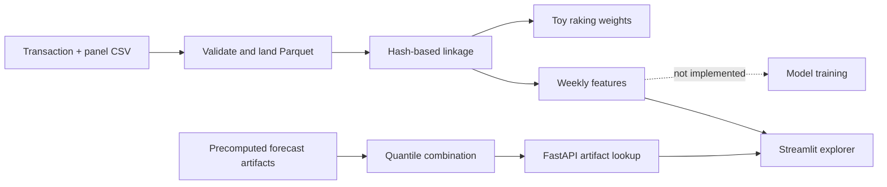

# SKU × region forecasting pipeline scaffold

A Python data-engineering prototype that ingests transaction and consumer-panel CSVs, links customer records with keyed hashes, computes toy panel weights, builds weekly SKU/region features, combines forecast-shaped artifacts, and serves stored quantiles through FastAPI.

**Training is not implemented.** The LightGBM, DeepAR, and PyMC entry points each raise `NotImplementedError`. There is no naive DeepAR fallback despite the earlier README's claim. The checked-in Parquet forecasts let the serving/dashboard layers be explored; their filenames are not evidence of trained models or measured forecast accuracy.

## What is implemented

| Stage | Current behavior |
| --- | --- |
| Ingestion | Required-column/date checks and Parquet landing files |
| Linkage | HMAC-SHA256 customer pseudonyms and panel/transaction linkage |
| Weighting | Iterative proportional fitting with illustrative demographic targets |
| Features | Weekly aggregation, lag-one units, rolling mean, calendar fields |
| Training | Three explicit stubs, not working model trainers |
| Ensemble | Combines supplied model-shaped quantiles and clips negative values |
| Serving | Reads stored forecast files for an SKU/region and returns a requested row count |
| Dashboard | Explores supplied data, features, artifacts, and the local API |



The feature builder reads the linked panel/credit artifact, not the separately written weighted-panel output. Do not claim that raking weights already influence the generated weekly targets. The “reconcile” module does not implement a full hierarchical reconciliation algorithm.

## Explore the data path

Use a disposable environment and the synthetic/example data under [`examples/sample_data/`](examples/sample_data/). `requirements-core.txt` omits some optional research/orchestration packages but still includes a substantial historical dependency set. Neither dependency set was reinstalled for this documentation update.

```sh
python -m venv .venv
source .venv/bin/activate
pip install -r requirements-core.txt
export DATA_DIR="$PWD/examples/sample_data"
# Set HASH_SALT to a unique local secret for any data beyond the supplied demo.
python -m src.ingest.ingest --credit_csv "$DATA_DIR/credit.csv" --panel_csv "$DATA_DIR/panel.csv"
python -m src.linking.link_panel_credit
python -m src.weighting.raking
python -m src.features.build_features
```

These commands write local output files and can replace the checked-in demonstration artifacts. Use a separate `DATA_DIR` when you want to preserve those originals. Raw CSV identifiers are still present in input/landing data; hashing the linkage key is pseudonymization, not anonymization. The default salt is a development placeholder and must not be used with real customer data.

The current rolling-mean feature includes the current week's target. Before training anything, define the prediction cutoff and shift any target-derived windows to prevent leakage. Missing weeks, evaluation splits, and realistic population marginals also need explicit treatment.

## Inspect the serving contract

With compatible dependencies and an available `forecast_ensemble.parquet` or `forecast_lgb.parquet` in the configured feature directory:

```sh
uvicorn src.serving.app:app --host 127.0.0.1 --port 8000
```

```http
POST /forecast
Content-Type: application/json

{"sku":"SKU123","region":"NE","horizon_weeks":2}
```

The API returns rows with `sku`, `region`, `date`, `q0.1`, `q0.5`, and `q0.9`. It sorts matching rows and takes the first requested count; it does not generate a new forecast, enforce a future-only date range, or fit a model per request. Missing artifacts or SKU/region pairs return 404. `GET /health` is liveness only.

`streamlit run streamlit_demo.py --server.address 127.0.0.1` opens the artifact explorer. Its status labels now describe artifact availability instead of implying successful model training. No new screenshot or runtime success is claimed without running that full dashboard environment.

## Checks and next useful milestone

The existing test suite covers ingestion, linking, weighting, features, validation, metrics, ensembling, configuration, hashing, and the artifact API. Run it with `python -m pytest tests -v` after installing compatible runtime/dev dependencies. This update was checked through source syntax and documentation review; the tests, models, dashboard, Airflow, and containers were not run.

The included Airflow DAG calls the unimplemented training tasks, so it is a proposed pipeline rather than a functioning end-to-end forecasting job. The next meaningful portfolio milestone is **one** reproducible baseline with a time-based holdout, leakage-safe features, and measured quantile/point accuracy. Adding more model names or claiming an ensemble advantage before that would not strengthen the project.
