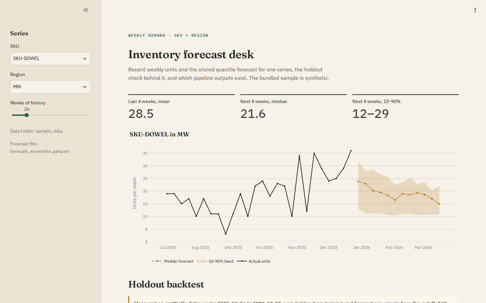
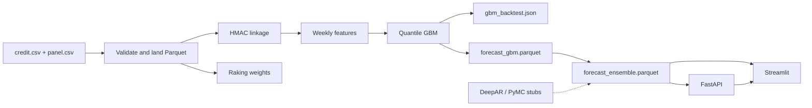
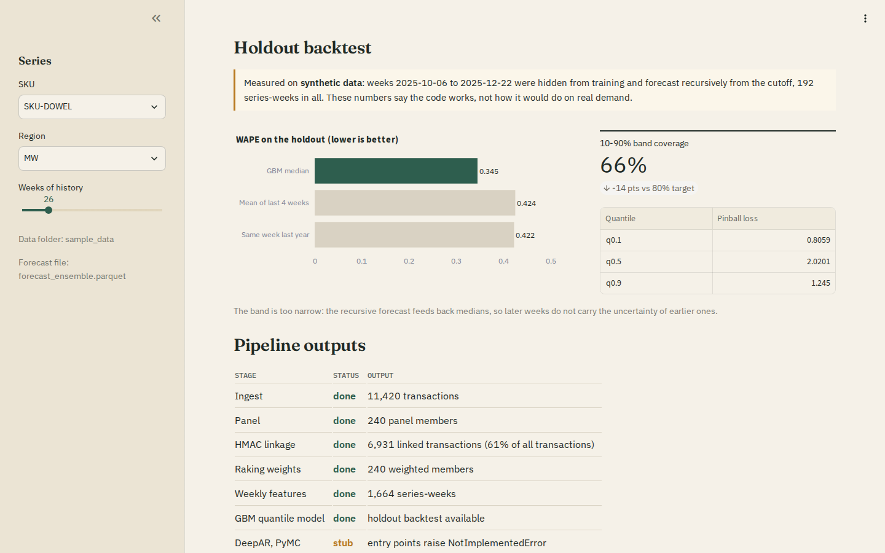
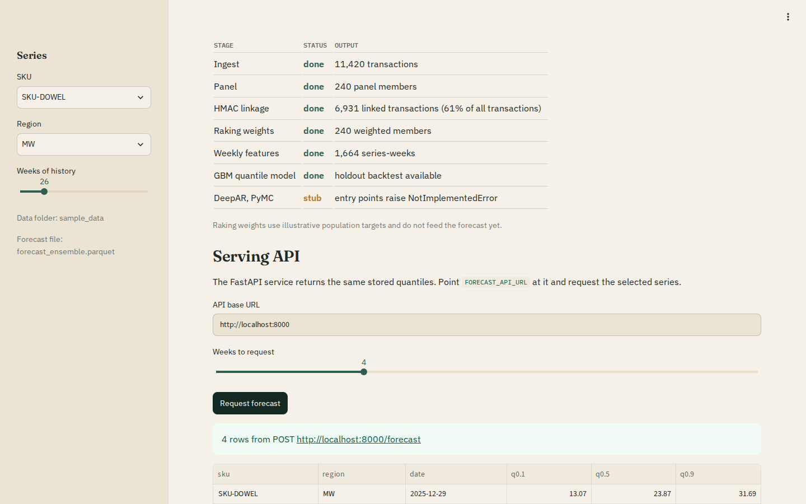
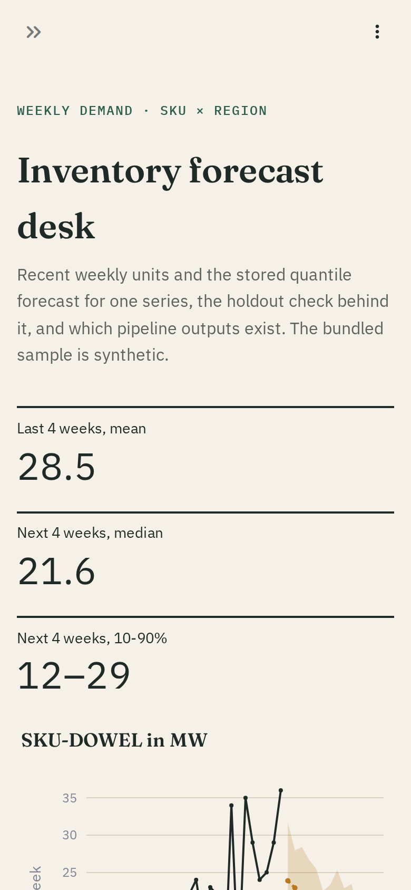

# Inventory forecast engine

A weekly demand forecasting pipeline for SKU × region series. It takes card-transaction and consumer-panel CSVs, links them through keyed pseudonyms, rolls them up to weekly features, fits a quantile gradient-boosting baseline, checks it on a time-based holdout and serves the stored 10th/50th/90th percentile forecasts through FastAPI and a Streamlit dashboard.

It is a working baseline, not a production forecaster. One trainer is real; two research trainers are still stubs, and the bundled data is synthetic.



## What is implemented

| Stage | Module | State |
| --- | --- | --- |
| Synthetic data | `src/synthetic.py` | Seeded generator for the bundled sample |
| Ingestion | `src/ingest/ingest.py` | Column, date, numeric and key checks; lands Parquet only if both files pass |
| Linkage | `src/linking/link_panel_credit.py` | HMAC-SHA256 pseudonyms keyed by `HASH_SALT`; raw IDs dropped from the linked table |
| Weighting | `src/weighting/raking.py` | Iterative proportional fitting against toy targets (not yet used downstream) |
| Features | `src/features/build_features.py` | Weekly totals, zero-filled gaps, past-only lags, calendar fields |
| Training | `src/models/train_gbm_quantile.py` | Quantile gradient boosting (scikit-learn) with a holdout backtest |
| | `train_deepar_gluonts.py`, `train_pymc_hierarchical.py` | Stubs that raise `NotImplementedError` |
| Ensemble | `src/ensemble/ensemble_and_reconcile.py` | Row-wise mean of available models, clipped and kept non-crossing; no hierarchical reconciliation |
| Serving | `src/serving/app.py` | `POST /forecast` returns stored rows for one series; `GET /health` |
| Dashboard | `streamlit_demo.py` | One series at a time, backtest, pipeline status, API panel |
| Orchestration | `dags/forecast_dag.py` | Airflow sketch; optional install, not tested here |



## Quick start (Docker)

```sh
docker compose up --build
```

- API: <http://localhost:8000/docs>
- Dashboard: <http://localhost:8501>

Both read the sample under `examples/sample_data/`, which already contains a trained forecast, so nothing else is needed to look around. The containers run as a non-root user and publish on localhost only.

Run the tests and linters in a container with networking disabled:

```sh
docker compose --profile test run --rm --build tests
```

Rebuild the whole data path from scratch (synthetic CSVs through to the ensemble) into a Docker volume. Linkage needs an HMAC key, so create `.env` first:

```sh
cp .env.example .env    # then replace the placeholder HASH_SALT
docker compose --profile pipeline run --rm pipeline
```

## Running it without Docker

Python 3.12 (see `.python-version`).

```sh
python -m venv .venv && source .venv/bin/activate
pip install -r requirements-core.txt -r requirements-dev.txt
make test lint   # or: python -m pytest && ruff check . && ruff format --check .
```

The pipeline, step by step. Point `DATA_DIR` at a scratch folder so the bundled sample stays untouched:

```sh
export DATA_DIR="$PWD/tmp/run"
export HASH_SALT="$(python -c 'import secrets; print(secrets.token_urlsafe(32))')"
python -m src.synthetic --out "$DATA_DIR"
python -m src.ingest.ingest --credit_csv "$DATA_DIR/credit.csv" --panel_csv "$DATA_DIR/panel.csv"
python -m src.linking.link_panel_credit
python -m src.weighting.raking
python -m src.features.build_features
python -m src.models.train_gbm_quantile --horizon 12 --holdout 12 --data-label synthetic
python -m src.ensemble.ensemble_and_reconcile
```

Then serve and explore what it produced:

```sh
uvicorn src.serving.app:app --host 127.0.0.1 --port 8000
streamlit run streamlit_demo.py --server.address 127.0.0.1
```

| Variable | Used by | Default |
| --- | --- | --- |
| `DATA_DIR` | every stage, API, dashboard | `examples/sample_data` |
| `HASH_SALT` | linkage (HMAC key, 16+ characters) | none; linkage refuses to run without it |
| `FORECAST_API_URL` | dashboard API panel | `http://localhost:8000` |
| `MLFLOW_TRACKING_URI` | trainer; logs the run only when set and `mlflow` is installed | unset |

## The baseline model

`train_gbm_quantile` fits one `HistGradientBoostingRegressor` with pinball loss for each of the 0.1, 0.5 and 0.9 quantiles. Inputs are the units sold one and two weeks earlier, the mean of the four weeks before, a yearly sine/cosine of the week number and integer SKU and region codes. Forecasts for several weeks are recursive: each week's median becomes the next week's lag. Predictions are clipped at zero and sorted per row so the quantiles never cross.

Every run starts with a holdout (`--data-label` records in the JSON what the data was, and the dashboard only calls it synthetic when it says so): the last `--holdout` weeks of every series are hidden, the model is trained on the rest and forecasts the hidden weeks from the cutoff. Two naive forecasts are scored on the same rows. The result on the bundled **synthetic** data (`examples/sample_data/features/gbm_backtest.json`, 16 series, holdout 2025-10-06 to 2025-12-22, 192 series-weeks):

| Forecast | WAPE |
| --- | --- |
| GBM median | 0.345 |
| Mean of the last 4 training weeks | 0.424 |
| Same week last year | 0.422 |

Pinball loss is 0.806 / 2.020 / 1.245 for q0.1 / q0.5 / q0.9. The 10–90% band covers **66%** of actuals against a nominal 80%, so the intervals are too narrow: feeding back medians drops the uncertainty of earlier forecast weeks. The synthetic demand is a smooth seasonal curve with Poisson noise, so these numbers show that the code and the evaluation work. They say nothing about real retail demand.



scikit-learn's histogram GBM stands in for LightGBM because the LightGBM wheel needs the system `libgomp`, which `python:3.12-slim` does not ship; the model family is the same.

## API

`POST /forecast` returns the first `horizon_weeks` stored rows for one series, earliest first. It does not fit anything per request.

```http
POST /forecast
Content-Type: application/json

{"sku": "SKU-DOWEL", "region": "MW", "horizon_weeks": 2}
```

```json
[
  {"sku": "SKU-DOWEL", "region": "MW", "date": "2025-12-29", "q0.1": 13.0656, "q0.5": 23.8691, "q0.9": 31.6942},
  {"sku": "SKU-DOWEL", "region": "MW", "date": "2026-01-05", "q0.1": 11.1320, "q0.5": 22.9251, "q0.9": 27.9657}
]
```

(Captured from the compose stack; the API returns full float precision, rounded here.)

- `sku` and `region` must be letters, digits, `-` or `_` (64 and 32 characters at most); `horizon_weeks` must be 1–52; unknown fields are rejected. Any of these returns 422.
- No forecast file, or no rows for the pair: 404.
- The artifact (`forecast_ensemble.parquet`, else `forecast_gbm.parquet`) is parsed once and re-read when the file changes.

The dashboard's API panel sends the same request for the selected series:



## Design notes

- **Pseudonyms need a secret.** The HMAC key comes only from `HASH_SALT`. A default key in the code would let anyone with the repository recompute every pseudonym from a customer ID. Pseudonymisation is not anonymisation: the input CSVs and landing files still hold raw IDs.
- **No target leakage in features.** The trailing mean covers the four weeks before the current one, and weeks with no sales are filled with zeros so that "last week" really is the previous calendar week. Every series runs to the last week in the data.
- **Ingest fails early and atomically.** Bad dates, non-numeric quantities, negative prices or duplicate IDs stop ingestion with the offending CSV line numbers, before anything is written.
- **Raking checks its targets.** Marginals must agree on the population total and cover every category present; otherwise IPF cannot converge. The weights are computed but do not feed the features yet.
- **Heavy research packages stay optional.** `requirements-core.txt` holds what the pipeline, API and dashboard need. MLflow, PyMC, ArviZ, GluonTS and Airflow are listed in `requirements-optional.txt` and are neither installed nor tested by default.



## Limitations and next steps

- DeepAR and PyMC trainers are stubs; the ensemble currently averages a single model.
- Prediction intervals under-cover on the holdout. Training direct multi-horizon models, or simulating quantile paths, would be the next fix.
- The ensemble does no hierarchical reconciliation across SKUs or regions.
- Raking targets are illustrative and the weights are not used in the features.
- The dashboard loads its fonts from Google Fonts and falls back to system fonts offline.
- The Airflow DAG is a sketch and has not been run.

## License

MIT, see [LICENSE](LICENSE).
